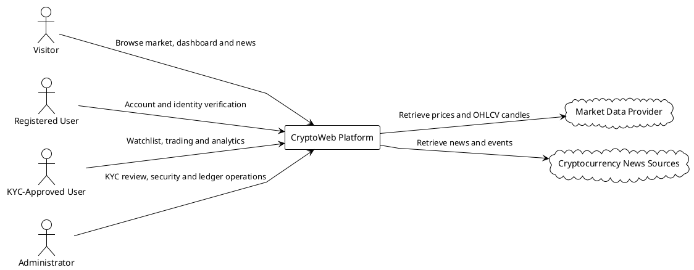
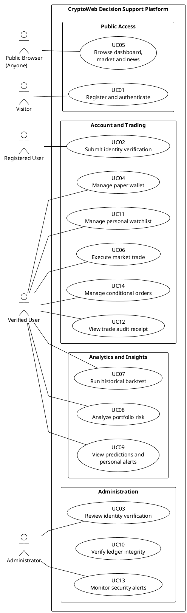
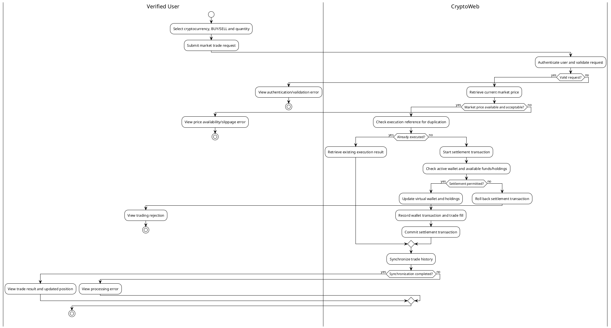
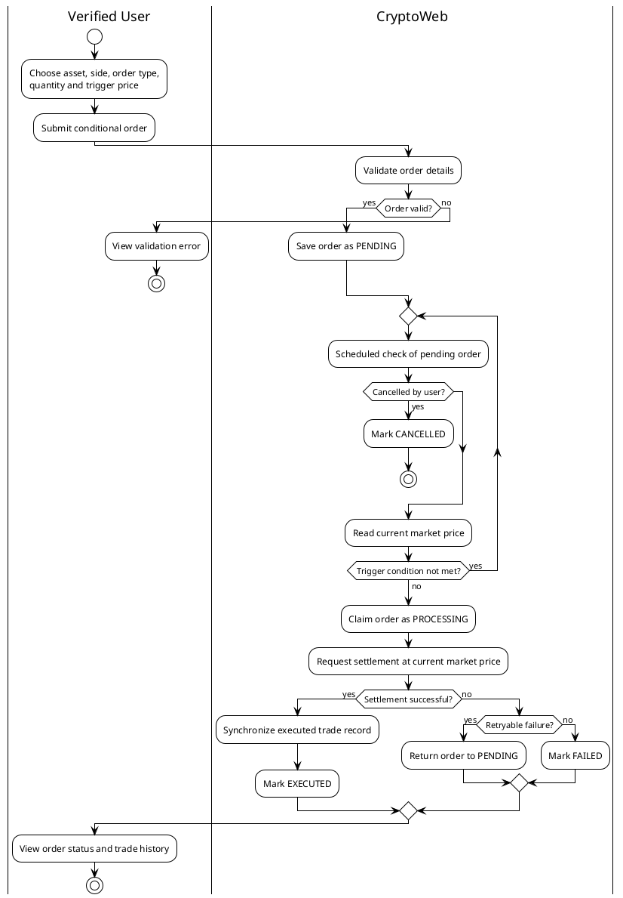
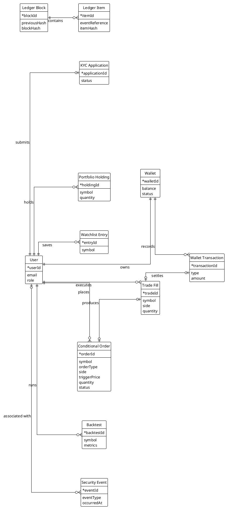

# CryptoWeb: Software Requirements Specification
**Secure Cryptocurrency Analytics, Paper Trading and Decision-Support Platform**

| Document field | Value |
|---|---|
| Document identifier | SRS-CW-001 |
| Version | 0.5 |
| Date | 15 November 2026 |
| Course | Software Engineering, NTUA School of Electrical and Computer Engineering, 2026–2027 |
| Author | Pranav |
| Project identifier | softeng26-XX (replace XX with the assigned identifier) |
| Status | Draft for review |

## Contents
1. [Introduction](#1-introduction)
2. [Software requirements](#2-software-requirements)
3. [Acceptance and scope boundaries](#3-acceptance-and-scope-boundaries)
4. [Glossary](#4-glossary)

## 1. Introduction

### 1.1 Purpose

CryptoWeb is a web-based cryptocurrency analytics, trading simulation, and decision-support platform designed to help users understand the complexities of cryptocurrency markets and make informed trading decisions.

Unlike conventional cryptocurrency trading platforms that primarily focus on buying, selling, and monitoring asset prices, CryptoWeb emphasizes the interpretation of market information. It combines cryptocurrency market data, portfolio analysis, technical indicators, historical strategy backtesting, asset correlation analysis, and news-driven risk assessment within a unified environment.

The platform enables users to explore how cryptocurrencies interact with one another, evaluate the potential impact of market fluctuations on their portfolios, assess historical trading strategies, and understand how relevant news and market events may influence investment risks.

In addition, CryptoWeb integrates security mechanisms, identity verification, machine-learning-based insights, and blockchain-based transaction auditing to support a secure and transparent simulated trading environment.

The primary objective of CryptoWeb is to transform complex financial and technical information into accessible, understandable, and actionable insights, allowing users to evaluate risks and make independent trading decisions based on comprehensive information rather than relying solely on price movements or trading signals.

### 1.2 Stakeholders and roles

| Stakeholder / actor | Role and interests |
|---|---|
| **Visitor (Guest)** | Anyone currently browsing without an authenticated session (including a registered account holder who is signed out); can access public Dashboard, Market and News pages, including coin details, candlestick charts and live prices, and may register or sign in. |
| **Registered User** | Signed-in account holder who may still be awaiting KYC approval; can manage account details, submit identity information, and use public sections. Registration alone does not grant access to protected features. |
| **Verified User** | Signed-in user with approved KYC; can use all public sections plus the personal watchlist, simulated trading, portfolio, backtesting, risk analysis and other approved functions. |
| **Administrator** | Authorized operator who reviews verification requests, manages permitted wallet and security operations, monitors alerts and verifies ledger integrity. |
| **Market Data Provider** | External service supplying cryptocurrency prices and historical market observations. |
| **News Provider** | External publisher or feed supplying cryptocurrency-related news and events. |

### 1.3 Product context and overview

CryptoWeb is a modular web application consisting of a React-based user interface, core application services, trading and analytics services, a machine-learning service, and persistent data storage.

The components communicate through REST APIs to provide an integrated platform. External market-data and news providers supply information used for cryptocurrency analysis and simulations.

The system uses MySQL for structured application and transactional data and MongoDB for market, analytical, and ledger-related records. The overall component relationships are illustrated in Figure 1.

**Figure 1 — System context**

### 1.4 Interfaces and external systems

**User interfaces**
- Public Dashboard, Market and News sections, with live cryptocurrency information, candle charts and relevant news, plus registration and sign-in.
- Authenticated account and identity-verification screens; verification is required for personal watchlist, trading, portfolio and other restricted analytical functions.
- Authorized administration screens for identity review, security alerts, ledger operations and audit records.
- Browser-based desktop presentation.

**Service interfaces and standards**
| Interface | Information exchanged | Standard / boundary |
|---|---|---|
| User interface to application services | Account requests, portfolio/trading actions, analytics queries and results | REST-style HTTP requests, JSON representations, access tokens |
| Trading to account/settlement services | Authorized simulated execution requests and resulting fill identifiers | Protected internal HTTP interfaces |
| Core services to prediction service | Prediction requests and security anomaly features/results | HTTP, JSON and service authentication |
| Market data | Symbols, reference prices and OHLCV observations | External cryptocurrency market-data API |
| News feed | Article metadata, event categories and sentiment context | External RSS or HTTP feed |
| Persistence | User accounts, wallets, trades, market data, audit records | Relational and document data stores |

The system obtains reference market data from Binance where that provider is used. News aggregation includes a Cointelegraph news feed. Availability and permitted usage depend on each provider’s terms and operating conditions.

### 1.5 Operating constraints and assumptions

- All wallet and trade values refer to a simulated environment; no real exchange account orders or bank transfers are performed.
- Market reference prices and relevant analytical results may be unavailable when upstream providers are unavailable.
- A device identifier associated with an account session is a software-generated identifier, not a hardware MAC address.
- Public market, dashboard and news information does not require sign-in. Personal watchlists require an authenticated, identity-verified account; restricted wallet, portfolio and trading functions require the applicable access permissions.
- Ledger records are internally hash-linked and tamper-evident; the platform is not a public decentralized blockchain network.
- A functional requirement is a statement of required product behavior, not an assertion that a particular performance target has already been measured.

## 2. Software requirements

### 2.1 Use-case model

A use case describes a goal accomplished through interaction with CryptoWeb. The **Public Browser (Anyone)** actor represents any person accessing the Dashboard, Market and News pages, whether signed in or not. Other actors represent account-related, verification-dependent or administrative roles. Market trades and conditional orders are represented as separate user goals.

**Figure 2 — Use-case model**

| ID | Use case | Primary actor |
|---|---|---|
| UC01 | Register and authenticate | Visitor / Registered User |
| UC02 | Submit identity verification | Registered User |
| UC03 | Review identity verification | Administrator |
| UC04 | Manage simulated wallet | Verified User |
| UC05 | Browse public dashboard, market data and news | Public Browser (Anyone) |
| UC06 | Execute simulated market trade | Verified User |
| UC07 | Run a historical strategy backtest | Verified User |
| UC08 | Analyze portfolio risk and relevant news | Verified User |
| UC09 | View predictions and personal alerts | Verified User |
| UC10 | Verify ledger integrity | Administrator |
| UC11 | Manage personal watchlist | Verified User |
| UC12 | View simulated trade audit receipt | Verified User |
| UC13 | Monitor security alerts | Administrator |
| UC14 | Manage conditional orders | Verified User |

### 2.2 Use-case specifications

#### 2.2.1 UC01: Register and authenticate

**Goal.** Register and authenticate.

**Participating roles.** Visitor (primary); Registered User (returning user).

**Preconditions.** The registration or login page is available; a returning user has an existing account.

**Execution environment.** Web browser and identity-management service.

**Input data.** Registration: email, telephone number, password. Login: account credentials.

**Main flow.**
1. The visitor chooses registration or login.
2. For registration, the platform validates identity fields and the password policy, creates an account and initializes the verification and wallet records.
3. For login, the platform checks credentials and issues session tokens.
4. The authenticated user is redirected to their available account functions.

**Alternative and exception flows.**
- Duplicate identity data or invalid fields cause registration to be rejected.
- Invalid credentials produce an authentication error.
- An expired access token may be refreshed if the session remains valid.

**Output data.** Account confirmation or authenticated session; applicable user identity and role.

**Exit conditions.** Account is created or access is granted; on failure no authenticated session is established.

**Special requirements.** Passwords are not stored in plaintext; unauthorized users cannot access protected operations.

#### 2.2.2 UC02: Submit identity verification

**Goal.** Submit identity verification.

**Participating roles.** Registered User (primary).

**Preconditions.** The user is authenticated and has an identity-verification application that may be submitted.

**Execution environment.** Web browser, identity-verification service and protected document storage.

**Input data.** Name, date of birth, country, passport details, optional identity-document images/files.

**Main flow.**
1. The user opens the identity-verification page.
2. The platform displays the application status and required fields.
3. The user enters the requested data and uploads supporting files where required.
4. The platform validates submitted information and stores the application with pending status.
5. The user receives a submission confirmation and can view the status.

**Alternative and exception flows.**
- Incomplete or invalid fields are rejected with an explanation.
- A previously approved or pending application cannot be resubmitted in an incompatible state.
- A rejected application follows the supported resubmission policy.

**Output data.** Stored verification request, document metadata and current status.

**Exit conditions.** Application moves to pending review or remains unchanged if validation fails.

**Special requirements.** Sensitive identity numbers and document content must be handled securely.

#### 2.2.3 UC03: Review identity verification

**Goal.** Review identity verification.

**Participating roles.** Administrator (primary); Registered User (notified of outcome).

**Preconditions.** The administrator is authenticated with review permission; a pending application exists.

**Execution environment.** Administrative web interface and verification/wallet services.

**Input data.** Application identifier, review outcome and optional review note.

**Main flow.**
1. The administrator views pending applications.
2. The platform displays applicant information required for review.
3. The administrator chooses approval or rejection.
4. The platform records the outcome and updates the application state.
5. For an approval, the associated wallet becomes active; for rejection it remains locked.

**Alternative and exception flows.**
- Insufficient privileges cause access to be denied.
- A completed or unavailable application cannot be reviewed twice inconsistently.

**Output data.** Review status, reviewer information and corresponding wallet status.

**Exit conditions.** The decision is recorded; the applicant can see the resulting verification status.

**Special requirements.** Review actions must be authorized and auditable.

#### 2.2.4 UC04: Manage simulated wallet

**Goal.** Manage simulated wallet.

**Participating roles.** Verified User (primary); Administrator (authorized adjustments).

**Preconditions.** The user is authenticated; changes to balance require an active wallet.

**Execution environment.** Wallet interface and transaction services.

**Input data.** Deposit/withdrawal amount, withdrawal-account information, transaction reference.

**Main flow.**
1. The user opens the wallet view and reads current status, balance and history.
2. The user chooses a simulated deposit or withdrawal.
3. The platform validates amount, wallet permissions and available funds where relevant.
4. The platform records the balance change and the associated wallet transaction.
5. The updated balance and transaction are presented to the user.

**Alternative and exception flows.**
- A locked wallet prevents balance-changing actions.
- Insufficient balance or an invalid amount causes the operation to fail without a balance change.
- Withdrawal details may be required for the selected operation.

**Output data.** Updated simulated wallet balance and transaction receipt/history record.

**Exit conditions.** Either balance and history are updated consistently or the request is rejected.

**Special requirements.** Operations do not transfer real fiat currency and must preserve non-negative balances.

#### 2.2.5 UC05: Browse public dashboard, market data and news

**Goal.** Browse cryptocurrency market information, coin charts and related news without requiring authentication.

**Participating roles.** Platform User (any Visitor, Registered User, Verified User or Administrator); Market Data Provider and News Provider (supporting).

**Preconditions.** Public information interfaces are available. Authentication is not required.

**Execution environment.** Public Dashboard, Market and News sections.

**Input data.** Selected cryptocurrency, chart interval, and available market or news filters.

**Main flow.**
1. The user opens the Dashboard, Market or News section.
2. The platform displays available cryptocurrency prices, live market information and coin details.
3. The user selects an asset and views its candlestick chart and historical OHLCV data.
4. The user may change the selected asset or chart interval.
5. The user opens the News section to read available market-related articles.

**Alternative and exception flows.**
- If a price feed, candle history or news source is unavailable, the platform displays the available information or an appropriate no-data message.
- If the user attempts to access a personal watchlist or another protected feature, access is denied and authentication or verification is requested as applicable.

**Output data.** Public market summaries, cryptocurrency details, live prices, candlestick charts and news entries.

**Exit conditions.** Public information is presented or an explanatory unavailable state is shown; no user-specific data is disclosed.

**Special requirements.** Public information is provided for reference and may be delayed or incomplete.

#### 2.2.6 UC06: Execute simulated market trade

**Goal.** Buy or sell a cryptocurrency immediately at the available market price using virtual funds.

**Participating roles.** Verified User (primary); Market Data Provider (supporting).

**Preconditions.** The user is signed in, KYC-approved and has an active simulated wallet.

**Execution environment.** Trading interface and simulated settlement services.

**Input data.** Asset symbol, BUY/SELL direction, positive quantity, and execution reference.

**Main flow.**
1. The user selects the asset, trade direction and quantity, then submits a market trade.
2. CryptoWeb validates the request and retrieves the current reference market price.
3. The system checks for duplicate execution of the reference and validates available funds or holdings.
4. The virtual wallet, portfolio holding and trade-fill record are updated transactionally.
5. The execution is synchronized with trade history, and the user receives the trade result.

**Alternative and exception flows.**
- Invalid input, insufficient funds or holdings, and inactive wallet status cause rejection.
- An unavailable reference price or unacceptable price deviation prevents settlement.
- A previously completed execution reference returns its earlier result without creating another fill.
- A downstream history-synchronization failure may occur after authoritative settlement and must be distinguishable from a rejected trade.

**Output data.** Executed quantity, reference execution price, trade identifier, updated wallet and position information.

**Exit conditions.** The trade is settled once, or settlement is rejected without a balance change.

**Special requirements.** Market trades use virtual funds and do not create real exchange transactions. Audit receipts may become available after ledger commitment.

**Figure 3 — Simulated market-trade activity**

#### 2.2.7 UC07: Run a historical strategy backtest

**Goal.** Run a historical strategy backtest.

**Participating roles.** Verified User (primary); Market Data Provider (supporting).

**Preconditions.** The user is authorized for strategy functions and the required historical market data is available.

**Execution environment.** Strategy/backtesting interface and historical-market computation service.

**Input data.** Asset, candle interval, start/end date, initial capital, short and long moving-average windows.

**Main flow.**
1. The user configures a moving-average crossover strategy and submits the backtest.
2. The platform validates dates, capital and moving-average parameters.
3. Historical OHLCV observations are retrieved for the selected range.
4. The platform calculates moving-average crossing signals and simulates positions over the price history.
5. It calculates portfolio-equity history, total return, maximum drawdown and number of trades.
6. The result is displayed and retained for later review.

**Alternative and exception flows.**
- Invalid dates, insufficient historical observations or invalid moving-average settings prevent execution.
- An unavailable external data source results in a non-successful response without a misleading backtest.

**Output data.** Strategy parameters, simulated trades, equity curve and performance indicators.

**Exit conditions.** A new backtest result is stored or a validation/unavailability result is shown.

**Special requirements.** Historical simulation does not guarantee future investment outcomes.

#### 2.2.8 UC08: Analyze portfolio risk and relevant news

**Goal.** Analyze portfolio risk and relevant news.

**Participating roles.** Verified User (primary); Market Data Provider and News Provider (supporting).

**Preconditions.** The user is authorized and has available portfolio positions; required market observations are accessible.

**Execution environment.** Portfolio risk dashboard and analytical services.

**Input data.** User portfolio, chosen asset, stress magnitude, selected risk view.

**Main flow.**
1. The user opens the portfolio risk dashboard.
2. The platform determines portfolio positions and current asset values.
3. It calculates volatility, concentration and a portfolio risk classification.
4. The user requests correlations or a stress scenario, including a shock to a selected asset.
5. The platform estimates portfolio-level and per-asset effects using supported correlation and scenario models.
6. Relevant news and potential risk drivers are presented with the calculated results.

**Alternative and exception flows.**
- An empty portfolio results in an empty or zero-value risk summary.
- Insufficient candle history limits correlation or volatility results.
- Invalid shock values produce a validation error, and unavailable market data produces an incomplete-data response.

**Output data.** Risk metrics, concentration breakdown, correlation/stress results and relevant news context.

**Exit conditions.** The user receives informational risk diagnostics without any automatic trade.

**Special requirements.** Estimated market impacts are scenario calculations, not causal claims or financial advice.

#### 2.2.9 UC09: View predictions and personal alerts

**Goal.** View available market predictions and personal alerts.

**Participating roles.** Verified User (primary).

**Preconditions.** The user is authenticated, satisfies applicable verification permissions and the required prediction/monitoring capability is available.

**Execution environment.** Insights and personal-alert interfaces; prediction and alert services.

**Input data.** Supported prediction parameters and personal-alert selections.

**Main flow.**
1. The user opens the predictions or insights section.
2. The platform retrieves available prediction results and history.
3. The platform presents personal alerts and information associated with the user.
4. The user reviews the available details.

**Alternative and exception flows.**
- Prediction service or provider unavailability produces a clear error or unavailable state.
- Restricted event/alert details are not provided to unauthorized users.

**Output data.** Prediction results, prediction history and personal-alert information.

**Exit conditions.** Requested information is shown or an appropriate access/data error is returned.

**Special requirements.** Prediction outputs are advisory and do not promise price accuracy.

#### 2.2.10 UC10: Verify ledger integrity

**Goal.** Inspect the internal ledger and verify the integrity of committed audit blocks.

**Participating roles.** Administrator (primary).

**Preconditions.** The administrator is authenticated and has permission to access ledger operations.

**Execution environment.** Ledger administration interface and integrity verification service.

**Input data.** Selected ledger or block and requested verification operation.

**Main flow.**
1. The administrator opens the ledger administration interface.
2. The system retrieves available ledger blocks and verification information.
3. The administrator requests verification of the selected chain or block range.
4. The system checks applicable hashes and block links and reports the verification result.

**Alternative and exception flows.**
- Unauthorized access is denied.
- If no committed blocks are available, the system reports their absence.
- Invalid hashes or links cause an integrity failure result.

**Output data.** Block information and integrity verification status.

**Exit conditions.** The verification result or an error is displayed.

**Special requirements.** The ledger is an internal tamper-evident structure and is not a decentralized public blockchain.

#### 2.2.11 UC11: Manage personal watchlist

**Goal.** Add, view and remove cryptocurrency assets in a personal watchlist.

**Participating roles.** Verified User (primary).

**Preconditions.** The user is signed in and has approved identity verification.

**Execution environment.** Protected watchlist interface and account-specific watchlist service.

**Input data.** Cryptocurrency symbol and requested add or remove action.

**Main flow.**
1. The verified user opens their watchlist.
2. The platform retrieves the assets saved to that user's account.
3. The user adds a supported cryptocurrency or removes an existing one.
4. The platform stores the change and displays the updated list.

**Alternative and exception flows.**
- An unauthenticated visitor cannot open or modify a personal watchlist.
- A signed-in user without approved identity verification is not granted watchlist access.
- Invalid or duplicate additions and removals of absent entries produce an appropriate response.

**Output data.** The user's current personal watchlist and confirmation of successful changes.

**Exit conditions.** The personal watchlist is displayed or modified, or the requested action is rejected without an unauthorized change.

**Special requirements.** Users may access and modify only watchlist entries associated with their own account.

#### 2.2.12 UC12: View simulated trade audit receipt

**Goal.** Retrieve an available audit receipt associated with the user's simulated trade.

**Participating roles.** Verified User (primary).

**Preconditions.** The user is authenticated and identity-verified, and the trade belongs to the user.

**Execution environment.** Authenticated web interface and receipt retrieval service.

**Input data.** Simulated trade identifier.

**Main flow.**
1. The user selects a completed simulated trade.
2. The system checks that the trade belongs to the user.
3. The system retrieves the corresponding receipt, if available.
4. The receipt details are presented to the user.

**Alternative and exception flows.**
- The user cannot access a receipt belonging to another account.
- If the relevant event has not been committed to the ledger, no receipt is available.
- Invalid references return an appropriate error.

**Output data.** Available trade receipt and ledger reference information.

**Exit conditions.** A receipt is displayed or an informative error is returned.

**Special requirements.** Receipt retrieval must enforce event ownership and must not disclose another user's records.

#### 2.2.13 UC13: Monitor security alerts

**Goal.** Review security alerts, suspicious authentication events and anomaly assessments.

**Participating roles.** Administrator (primary).

**Preconditions.** The administrator is authenticated and authorized to access security monitoring.

**Execution environment.** Administrative security and alert-management interfaces.

**Input data.** Alert filters, security-event references, and authorized status updates.

**Main flow.**
1. The administrator opens security monitoring.
2. The platform retrieves authorized alerts and associated event details.
3. The administrator inspects relevant session-risk and anomaly indicators.
4. The administrator updates alert status where permitted.

**Alternative and exception flows.** Unauthorized access is denied; missing events or unavailable scoring are reported appropriately.

**Output data.** Alert listings, event details, risk indicators and review status.

**Exit conditions.** Authorized information is displayed and any permitted status change is stored.

**Special requirements.** Sensitive session information shall be accessible only to permitted roles.

#### 2.2.14 UC14: Manage conditional orders

**Goal.** Create, monitor, update or cancel simulated conditional trading orders.

**Participating roles.** Verified User (primary); Market Data Provider (supporting).

**Preconditions.** The user is authenticated, KYC-approved and has access to the simulated trading interface.

**Execution environment.** Trading interface, pending-order management and periodic execution service.

**Input data.** Asset symbol, order type (LIMIT or STOP), BUY/SELL direction, positive quantity and trigger price.

**Main flow.**
1. The user creates a LIMIT BUY, LIMIT SELL or STOP-LOSS SELL order by selecting an asset, quantity and specified price.
2. CryptoWeb validates the order and stores it with PENDING status.
3. The execution service periodically compares the market price with the stored price condition.
4. If the condition is satisfied, the system claims the pending order and requests settlement at the current market price.
5. Following successful settlement, the system records the executed trade and changes the order status to EXECUTED.
6. The user views current pending orders or the resulting trade history.

**Alternative and exception flows.**
- The user may update the quantity or price, or cancel an order while it remains PENDING.
- A LIMIT BUY triggers when market price is at or below its specified price; a LIMIT SELL triggers when market price is at or above it.
- A STOP-LOSS SELL triggers when market price is at or below its specified stop price; STOP BUY is unsupported.
- Until the trigger occurs, the order remains pending; unsuccessful settlement may result in FAILED status or a retry, depending on the error.
- Market price may move between trigger detection and execution, so the specified price is not guaranteed as the fill price.

**Output data.** Order identifier, type, target price, quantity, current status, and executed trade details when applicable.

**Exit conditions.** The order remains PENDING, is CANCELLED, fails, or is EXECUTED.

**Special requirements.** Only eligible simulated trades may be settled; the system does not submit orders to a live cryptocurrency exchange.

**Figure 4 — Conditional order monitoring and execution**

### 2.3 Functional requirements

Each requirement has a unique identifier, an action-oriented title and a testable behavioral statement. “Shall” indicates required system behavior.

#### Identity and access

| ID | Requirement | Specification |
|---|---|---|
| **FR01** | **User registration** | The platform shall allow a visitor to register with an email address, telephone number and password that satisfies the configured password policy. |
| **FR02** | **Account initialization** | The platform shall create a user profile, an identity-verification application and an initially locked simulated wallet when a new account is created. |
| **FR03** | **Authentication** | The platform shall authenticate a user with valid credentials and provide access and refresh tokens for authorized sessions. |
| **FR04** | **Session renewal and termination** | The platform shall support access-token renewal, refresh-token rotation, logout and invalidation of revoked refresh tokens. |
| **FR05** | **Role-based access** | The platform shall distinguish ordinary users from administrators and authorize restricted operations according to the authenticated role. |
| **FR06** | **Login event capture** | The platform shall record successful and unsuccessful login events, together with available request and device context. |

#### Identity verification and wallet

| ID | Requirement | Specification |
|---|---|---|
| **FR07** | **Identity-verification submission** | An authenticated user shall be able to submit identity-verification details and view their application status. |
| **FR08** | **Supporting documents** | The platform shall accept supporting identity documents and retain metadata sufficient to validate the integrity of uploaded files. |
| **FR09** | **Administrative review** | An administrator shall be able to inspect pending identity-verification applications and approve or reject them. |
| **FR10** | **Wallet activation** | Approval of an identity-verification application shall activate the associated wallet; rejection shall leave the wallet locked. |
| **FR11** | **Wallet information** | A user shall be able to view their simulated wallet balance, status and transaction history. |
| **FR12** | **Wallet operations** | An eligible user shall be able to perform simulated deposits and withdrawals, provided amount, wallet-status and balance rules are satisfied. |
| **FR13** | **Withdrawal-account details** | An eligible user shall be able to manage the withdrawal-account information associated with their simulated wallet. |
| **FR14** | **Administrative adjustment** | An authorized administrator shall be able to record an adjustment to a simulated wallet with a corresponding transaction history entry. |

#### Market information, trading and portfolio

| ID | Requirement | Specification |
|---|---|---|
| **FR15** | **Public market and dashboard information** | Without authentication, a visitor shall be able to access the Dashboard and Market sections to view supported cryptocurrency details, live reference prices, candlestick/OHLCV history and market summaries. |
| **FR16** | **Simulated market orders** | An eligible user shall be able to request a simulated BUY or SELL for a supported asset and a positive quantity. |
| **FR17** | **Trade settlement** | The platform shall obtain a current external reference price, apply applicable price-deviation checks, and update wallet balance, holdings and trade history as one authoritative transaction. |
| **FR18** | **Duplicate order protection** | The platform shall avoid executing a simulated trade more than once for the same user and execution reference. |
| **FR19** | **Portfolio information** | The platform shall show positions, quantities, average acquisition costs, current market values and unrealized gains or losses where pricing is available. |
| **FR20** | **Trading history and orders** | An eligible user shall be able to view their own simulated trades and pending orders, update the price or quantity of pending orders through available services, and cancel pending orders. |
| **FR21** | **Conditional orders** | An eligible user shall be able to create LIMIT BUY, LIMIT SELL and STOP-LOSS SELL orders. The system shall trigger execution when the market price is respectively at or below, at or above, or at or below the user-specified price; triggered orders shall be settled at the then-current reference market price, subject to eligibility and available balances or holdings. |
| **FR22** | **Protected watchlist management** | An authenticated user with approved identity verification shall be able to view, add and remove assets in their own personal watchlist. Unauthenticated visitors and unverified account holders shall not be granted watchlist access. |

#### Analytics, news and machine learning

| ID | Requirement | Specification |
|---|---|---|
| **FR23** | **Backtest configuration** | An eligible user shall be able to run a historical moving-average crossover strategy with a selected asset, time interval, date range, moving-average windows and starting capital. |
| **FR24** | **Backtest results** | The platform shall provide the simulated trades, equity curve, total return, maximum drawdown and trade count for a successful backtest and retain the result for later retrieval. |
| **FR25** | **Portfolio risk summary** | The platform shall calculate per-asset volatility, portfolio concentration and a risk classification using available holdings and market observations. |
| **FR26** | **Stress and correlation analysis** | The platform shall calculate selected percentage-shock scenarios, pairwise asset-return correlations and estimates of correlation-based shock propagation. |
| **FR27** | **Public market news** | The News section shall be accessible without authentication and present available cryptocurrency news with publication metadata, sentiment categories and identified affected assets where available. |
| **FR28** | **News-related risk** | The platform shall associate relevant adverse news with portfolio exposures and produce scenario-based impact estimates. |
| **FR29** | **Prediction service** | An authenticated user shall be able to request available price-prediction outputs and review prediction history. |

#### Security, alerts and audit

| ID | Requirement | Specification |
|---|---|---|
| **FR30** | **Security event history** | The platform shall record relevant authentication and session events and provide authorized access to user-specific security information. |
| **FR31** | **Session risk assessment** | The platform shall assess session risk using recorded behavioral indicators and incorporate anomaly scores when the prediction service is available. |
| **FR32** | **Alerts** | The platform shall present generated security or analytics alerts and support authorized alert-status updates. |
| **FR33** | **Tamper-evident records** | The platform shall preserve eligible trading, wallet and security events in an internal hash-linked ledger whose integrity can be checked. |
| **FR34** | **Audit receipts** | An authorized requester shall be able to retrieve an available audit receipt for an eligible transaction or security event. |
| **FR35** | **Ledger administration** | An administrator shall be able to inspect ledger blocks, initiate supported commitments, verify integrity and perform authorized finalization operations. |

#### Platform interfaces and consistency

| ID | Requirement | Specification |
|---|---|---|
| **FR36** | **Separated service interfaces** | The platform shall expose distinct service interfaces for account/security functions and market/trading/analytics functions, using documented JSON-based HTTP requests. |
| **FR37** | **Request traceability** | The platform shall associate a request identifier with operations for which correlation across services and logs is required. |
| **FR38** | **Protected internal operations** | Service-to-service operations that create authoritative trade records or request protected computations shall require internal service authorization. |
| **FR39** | **Verification-based access** | The watchlist, portfolio, trading, strategy and risk functions shall be available only to authenticated users with approved identity verification, except for authorized administrators. Public Dashboard, Market and News functions shall remain accessible to visitors. |
| **FR40** | **Command-line access** | The Layered architecture version shall provide a command-line client for selected functions, using the documented REST API rather than direct access to internal data storage. |
| **FR41** | **Desktop web presentation** | The platform shall provide a desktop-browser interface for public market information and authorized account, portfolio, simulation, analytics and administrative functions. |

### 2.4 Business rules

| Rule | Specification |
|---|---|
| BR01 | Registration passwords shall satisfy the configured minimum and maximum length (12–72 characters). |
| BR02 | A newly registered user has a locked wallet with zero simulated balance. |
| BR03 | Identity-verification status governs wallet activation and access to gated features. |
| BR04 | The supported identity-document category is passport. |
| BR05 | Wallet withdrawals and simulated purchases shall not result in a negative available balance. |
| BR06 | A simulated execution reference is unique for a user and cannot be processed twice. |
| BR07 | A simulated market order uses an external reference price, not an arbitrary user-entered execution price. |
| BR08 | Pending-order types include LIMIT BUY, LIMIT SELL and STOP-LOSS SELL; STOP BUY is not supported. |
| BR12 | LIMIT BUY triggers at or below the specified price; LIMIT SELL at or above; STOP-LOSS SELL at or below. A price trigger does not guarantee settlement or a particular execution price. |
| BR13 | Pending orders may be updated or cancelled before processing; successful settlement changes their status to EXECUTED, while other outcomes include PENDING, PROCESSING, FAILED and CANCELLED. |
| BR09 | The historical backtesting strategy uses a moving-average crossover with hourly or daily candles. |
| BR10 | Ledger receipts may be unavailable before the corresponding event has been committed. |
| BR11 | News-related shock scenarios are estimates and shall not be represented as measured causal effects. |

### 2.5 Non-functional requirements

The following requirements describe required quality and integrity properties. Acceptance targets must be demonstrated through the relevant functional, security or performance tests.

| ID | Quality attribute | Requirement |
|---|---|---|
| **NFR01** | **Authentication and credential protection** | All authenticated operations shall require a valid session credential; stored passwords and refresh credentials shall not be kept in plaintext. |
| **NFR02** | **Authorization** | Users shall be restricted to their own private portfolio, trading, wallet and document data; administrative operations shall require the appropriate role. |
| **NFR03** | **Input validation** | The platform shall reject malformed identity, trading, wallet and analytical input without changing authoritative records. |
| **NFR04** | **Request hardening** | The public HTTP services shall apply appropriate security headers, request-size limits and rate limiting to reduce accidental or abusive requests. |
| **NFR05** | **Sensitive identity data** | Sensitive identity-document numbers shall be protected by cryptographic storage controls; document uploads shall retain integrity metadata. |
| **NFR06** | **Financial-state consistency** | Wallet debit/credit and trade settlement operations shall preserve non-negative balances, prevent duplicate processing and maintain consistent holdings. |
| **NFR07** | **Auditability** | Significant authentication, wallet, trade, security and administrative actions shall be attributable to request or event identifiers and be available for permitted review. |
| **NFR08** | **Service communication** | Protected calls between application services shall use explicitly configured service authentication and shall not rely on trust in the caller alone. |
| **NFR09** | **Robustness** | If an external price/news source or an internal analytical service is unavailable, the platform shall return a distinguishable error or incomplete-data state rather than a fabricated successful result. |
| **NFR10** | **Usability** | The desktop-browser interface shall distinguish publicly available sections from restricted features, provide consistent navigation and clearly explain access-denial states. |
| **NFR11** | **Performance acceptance** | During documented load tests with 10 concurrent test users, at least 95% of successful local wallet and portfolio read operations should complete within 3 seconds, excluding third-party provider waiting time. This is an acceptance target to be tested. |
| **NFR12** | **Data integrity and recovery** | Persistent records shall use database validation and uniqueness controls; operations involving asynchronous cross-service synchronization shall support detection or recovery of missed updates. |
| **NFR13** | **Maintainability** | External interfaces and business responsibilities shall be defined so that individual services and presentation views can evolve without changing user-visible functional requirements. |
| **NFR14** | **Privacy and configuration** | Application credentials and secret keys shall be managed through deployment configuration, and private user data shall not be included in publicly distributed test dumps. |
| **NFR15** | **Interoperability** | Publicly exposed programmatic interfaces shall use documented REST/HTTP interactions with JSON representations where applicable. |

### 2.6 Requirements-to-use-case mapping

The mapping indicates which user interaction exercises each functional requirement. Cross-cutting requirements may support multiple use cases.

| Requirement | UC01 | UC02 | UC03 | UC04 | UC05 | UC06 | UC07 | UC08 | UC09 | UC10 | UC11 | UC12 | UC13 | UC14 |
|---|:---:|:---:|:---:|:---:|:---:|:---:|:---:|:---:|:---:|:---:|:---:|:---:|:---:|:---:|
| FR01 | X | – | – | – | – | – | – | – | – | – | – | – | – | – |
| FR02 | X | – | – | – | – | – | – | – | – | – | – | – | – | – |
| FR03 | X | X | – | X | – | X | – | – | X | – | – | X | – | X |
| FR04 | X | – | – | – | – | – | – | – | – | – | – | – | – | – |
| FR05 | X | X | X | – | – | X | – | – | X | X | X | X | X | X |
| FR06 | X | – | – | – | – | – | – | – | X | – | – | – | X | – |
| FR07 | – | X | – | – | – | – | – | – | – | – | – | – | – | – |
| FR08 | – | X | – | – | – | – | – | – | – | – | – | – | – | – |
| FR09 | – | – | X | – | – | – | – | – | – | – | – | – | – | – |
| FR10 | – | – | X | X | – | X | – | – | – | – | – | – | – | X |
| FR11 | – | – | – | X | – | – | – | – | – | – | – | – | – | – |
| FR12 | – | – | – | X | – | – | – | – | – | – | – | – | – | – |
| FR13 | – | – | – | X | – | – | – | – | – | – | – | – | – | – |
| FR14 | – | – | – | X | – | – | – | – | – | – | – | – | – | – |
| FR15 | – | – | – | – | X | – | X | X | – | – | – | – | – | – |
| FR16 | – | – | – | – | – | X | – | – | – | – | – | – | – | – |
| FR17 | – | – | – | – | – | X | – | – | – | – | – | – | – | X |
| FR18 | – | – | – | – | – | X | – | – | – | – | – | – | – | X |
| FR19 | – | – | – | – | – | X | – | X | – | – | – | – | – | – |
| FR20 | – | – | – | – | – | X | – | – | – | – | – | – | – | X |
| FR21 | – | – | – | – | – | – | – | – | – | – | – | – | – | X |
| FR22 | – | – | – | – | – | – | – | – | – | – | X | – | – | – |
| FR23 | – | – | – | – | – | – | X | – | – | – | – | – | – | – |
| FR24 | – | – | – | – | – | – | X | – | – | – | – | – | – | – |
| FR25 | – | – | – | – | – | – | – | X | – | – | – | – | – | – |
| FR26 | – | – | – | – | – | – | – | X | – | – | – | – | – | – |
| FR27 | – | – | – | – | X | – | – | X | – | – | – | – | – | – |
| FR28 | – | – | – | – | – | – | – | X | – | – | – | – | – | – |
| FR29 | – | – | – | – | – | – | – | – | X | – | – | – | – | – |
| FR30 | – | – | – | – | – | – | – | – | – | X | – | – | X | – |
| FR31 | – | – | – | – | – | – | – | – | – | – | – | – | X | – |
| FR32 | – | – | – | – | – | – | – | – | – | – | – | – | X | – |
| FR33 | – | – | – | – | – | – | – | – | – | X | – | – | – | – |
| FR34 | – | – | – | – | – | – | – | – | – | X | – | X | – | – |
| FR35 | – | – | – | – | – | – | – | – | – | X | – | – | – | – |
| FR36 | – | – | – | – | X | X | X | X | X | – | – | – | – | – |
| FR37 | X | – | X | X | – | X | – | – | X | X | – | X | X | X |
| FR38 | – | – | – | – | – | X | – | – | – | X | – | – | – | X |
| FR39 | – | X | – | X | – | X | X | X | X | – | X | – | – | X |
| FR40 | – | – | – | – | X | – | – | – | – | – | – | – | – | – |
| FR41 | – | – | – | – | X | – | – | X | – | – | X | X | – | – |

### 2.7 Data requirements

#### 2.7.1 Data domains
The principal data domains cover identity and verification, simulated financial records, market observations, saved analytics, security information and audit-ledger evidence. Core account, wallet and settled trade information requires transactional consistency; market and analytical records include time series and other flexible document structures.

| Entity / aggregate | Purpose | Representative fields |
|---|---|---|
| **User** | Registered identity, profile, role and account status. | userId, email, phone, password credential, role |
| **Verification Application** | Identity submission, verification decision and reviewer information. | applicationId, userId, status, submittedAt, reviewedAt |
| **Verification Document** | Supporting document metadata and integrity evidence. | documentId, applicationId, type, file hash |
| **Wallet** | User-owned simulated cash balance and activation state. | walletId, userId, balance, currency, status |
| **Wallet Transaction** | History of simulated balance-changing operations. | transactionId, walletId/userId, type, amount, balanceAfter |
| **Portfolio Holding** | Current quantity and average cost of an asset. | userId, assetSymbol, quantity, averageCost |
| **Watchlist Entry** | Cryptocurrency saved to an identity-verified user's personal watchlist. | userId, assetSymbol |
| **Trade Fill** | Execution details and relation to wallet changes. | tradeId, userId, referenceId, side, assetSymbol, quantity, price |
| **Market Candle** | Timestamped price/volume observations for an asset. | symbol, interval, timestamp, OHLCV |
| **Pending Order** | Conditions for a simulated conditional order. | orderId, userId, orderType, side, targetPrice, status |
| **Backtest** | Saved strategy configuration, trades and results. | backtestId, userId, parameters, dateRange, equityCurve, metrics |
| **News Article** | News metadata, sentiment, affected assets and links. | articleId, title, publishedAt, sentiment, category, affectedAssets |
| **Security Event** | Security/session occurrence and associated risk indicators. | eventId, userId, eventType, occurredAt, IP, device identifier |
| **Alert** | Alert severity, type and review status. | alertId, userId, type, severity, status |
| **Ledger Block / Item** | Hash-linked event records and verification evidence. | blockId, previousHash, blockHash, eventReference, itemHash |

#### 2.7.2 Conceptual data model
**Figure 5 — Principal domain entities and associations**

The diagram is conceptual: it represents business relationships and does not imply that every association is stored as a physical foreign key across the relational and document databases.

#### 2.7.3 Data accuracy and integrity
- Wallet balances and recorded trade fills shall be consistent following authoritative settlement.
- User identity, contact identifiers and execution references shall respect their required uniqueness constraints.
- Stored historical backtest results shall remain associated with the requesting account and configuration.
- Security and ledger records shall support verification of relevant events without exposing private information to other users.
- Where the trading service maintains a copy of settled data, differences shall be detectable and eligible for synchronization.

#### 2.7.4 Data sources and retention
Market observations originate from permitted external cryptocurrency data services and are stored or cached as needed for charts, analysis and backtesting. News data originates from permitted external feeds. Account, simulated transaction, verification and security information is stored in the platform’s persistence services.

Sensitive data shall be retained only as needed for defined account, operational and audit requirements. Specific legal retention periods and backup schedules must be set through the deployment and data-governance policy rather than assumed here.

## 3. Acceptance and scope boundaries

### 3.1 Acceptance approach

Acceptance evidence consists of functional tests for primary and alternate use-case flows, interface tests for exposed REST APIs, authorization and integrity checks, and performance measurements for the selected read and analytical operations. Each functional requirement should be associated with at least one test in the test documentation.

### 3.2 Product exclusions

- Submission of real cryptocurrency exchange orders or custody of actual user funds.
- Real deposits or withdrawals via banking/payment-provider settlement.
- Guaranteed price forecasts, deterministic future investment performance or personalized regulated investment advice.
- Distributed consensus among independent public blockchain validators.

### 3.3 Architectural presentation requirements

The required architecture models describe the Layered and MVC perspectives of the platform. REST interfaces connect the browser presentation with application services; the Layered architecture additionally includes a command-line interface using the documented REST API. Architecture-specific class, component, deployment and API models are maintained as separate design deliverables.

## 4. Glossary

| Term | Definition |
|---|---|
| **Backtest** | Simulation of a strategy over historical market observations. |
| **Correlation** | Statistical relationship between the movements of asset return series. |
| **KYC** | Identity-verification process applied to access restricted features. |
| **JWT** | JSON Web Token, used for authenticated session authorization. |
| **Ledger receipt** | Evidence connecting an eligible event to an internally stored audit-ledger record. |
| **OHLCV** | Open, High, Low, Close and Volume market observations for a time interval. |
| **Paper trading** | Simulated trading with internal balances and holdings, without exchange execution. |
| **Slippage tolerance** | Configured allowed difference between an expected reference price and the execution reference price. |
| **Stress scenario** | Hypothetical market movement used to estimate potential impact on positions. |
